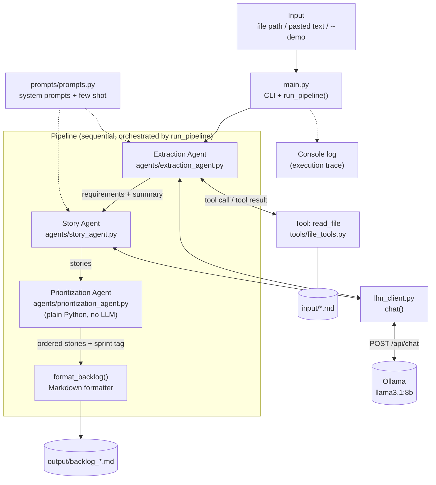
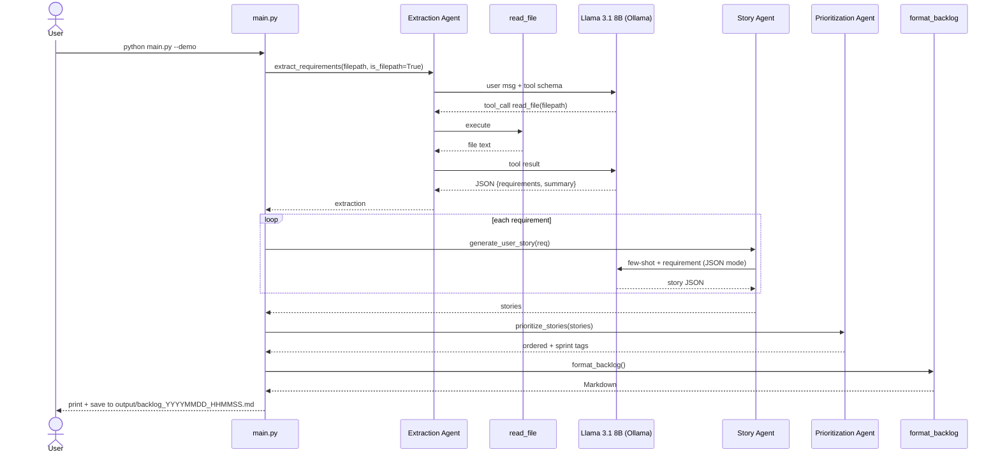

# Smart Backlog Assistant — Architecture & Technical Overview

## 1. Problem Statement

After planning meetings, product teams manually convert unstructured notes into backlog items.
This is slow and inconsistent: requirements are missed, stories vary in quality, and priorities
are subjective. Internal notes also often cannot be sent to a cloud LLM.

**Solution.** A local, multi-step LLM pipeline that converts meeting notes into a prioritized
backlog of user stories with acceptance criteria, using **Llama 3.1 8B served by Ollama**
(`http://localhost:11434`). No data leaves the machine.

## 2. Architecture



**Layers**

| Layer | Files | Responsibility |
|---|---|---|
| Entry / orchestration | `main.py` | CLI, runs the steps in order, formats and saves output |
| Agents | `agents/` | One module per pipeline step |
| Tools | `tools/file_tools.py` | `read_file` function, its schema, registry, tool loop |
| Prompts | `prompts/prompts.py` | System prompts and the few-shot example |
| Model access | `llm_client.py` | Single `chat()` function calling Ollama |

## 3. Agents

| # | Agent | Uses LLM | Tools | Input | Output |
|---|---|---|---|---|---|
| 1 | **Extraction** | Yes (tool calling for files, JSON mode for text) | `read_file` | File path or raw text | `{requirements:[{id,text,source,type}], summary}` |
| 2 | **Story** | Yes (few-shot, JSON mode, one call per requirement) | – | One requirement | `{story, acceptance_criteria, story_points, priority, category, requirement_id}` |
| 3 | **Prioritization** | No | – | List of stories | Same stories, sorted, each with `sprint_suggestion` |

Prioritization rules (`prioritization_agent.py`): sort by priority (high=3, medium=2, low=1)
descending, then story points ascending. `high` → `sprint_1`; `medium` with ≤5 points → `sprint_2`;
everything else → `backlog`. It is deterministic code because an 8B model is unreliable at
re-ordering long JSON.

## 4. Shared State

There is **no global state store or state object**. State is passed explicitly, in memory, from
one step to the next by `run_pipeline()` in `main.py`:

| State | Produced by | Consumed by | Shape |
|---|---|---|---|
| `extraction` | Extraction Agent | Story Agent, formatter (`summary`) | dict: `requirements` list + `summary` |
| `stories` | Story Agent | Prioritization Agent | list of dicts, each linked to a requirement by `requirement_id` |
| `prioritized` | Prioritization Agent | `format_backlog()` | same list, ordered, with `sprint_suggestion` |
| `messages` | Tool loop (inside Extraction) | Ollama | conversation list incl. assistant tool calls and `tool` results |

Nothing is persisted between runs except the final Markdown file. The `requirement_id` field is
the key that links each story back to the requirement it came from.

## 5. Tools (and MCP)

| Tool | Type | Description |
|---|---|---|
| `read_file(filepath)` | Local Python function exposed through **Ollama native tool calling** | Returns file text, or an `ERROR: ...` string if missing/unreadable |

**This project does not use MCP (Model Context Protocol).** The tool is declared as a JSON
function schema (`TOOL_DEFINITIONS`), sent to Ollama in the request, and executed in-process via
`TOOL_REGISTRY`. The design maps cleanly onto MCP: `read_file` could be moved into an MCP server
as a tool with the same name and input schema, and `execute_tools()` replaced with an MCP client
call, without changing the agents or prompts.

## 6. End-to-End Execution Flow



Steps:

1. **Input** — `--demo` loads `input/sample_meeting_notes.md`; `--file` takes a path; with no flag, pasted text is read.
2. **Extract** — for file input the model calls `read_file`, receives the text, and returns requirements JSON. For pasted text, the text goes straight to the model in JSON mode.
3. **Generate** — one few-shot LLM call per requirement produces a story.
4. **Prioritize** — stories are sorted and assigned a sprint.
5. **Format and save** — grouped by sprint into Markdown, printed, and written to `output/`.

## 7. Expected Outcomes

For the bundled sample notes (5 issues: Firefox login bug, slow dashboard, newsletter toggle,
CSV export for compliance, Python 2 ETL upgrade with a CVE), a correct run produces:

- About 5 requirements (the model may split or merge an item, giving 5–6)
- One user story per requirement, each with 3–4 acceptance criteria, Fibonacci points (1/2/3/5/8), a priority and a category
- A backlog grouped into Sprint 1 / Sprint 2 / Backlog, with high-priority and compliance-driven items (login bug, CSV export, ETL/CVE, dashboard performance) near the top and the newsletter toggle lower
- A Markdown file in `output/` and a complete trace in the console

## 8. How Outcomes Are Determined (Input → Output → Trace)

An outcome is judged by checking that **the output is faithful to the input** and that **the
trace shows each step actually ran**.

**A. Input** — the notes file. Count the distinct issues; this is the reference list.

**B. Output** — `output/backlog_*.md`. Check:

| Check | Pass condition |
|---|---|
| Coverage | Every issue in the input appears in at least one story |
| Faithfulness | No story describes something absent from the input |
| Structure | Each story is "As a… I want… so that…", with 3–4 criteria, valid points, priority and category |
| Ordering | Stories appear high → medium → low; within a priority, fewer points first |
| Sprint tags | `high` in Sprint 1; `medium` with ≤5 points in Sprint 2; the rest in Backlog |

**C. Execution trace** — console log lines, which show the pipeline's path:

```
Starting Smart Backlog Assistant pipeline...
Step 1: Extracting requirements...
Tool call: read_file({'filepath': 'input/sample_meeting_notes.md'})   <- tool calling worked
Tool result: Meeting Notes — Sprint Planning ...                      <- file was read
Extracted 5 requirements                                              <- extraction count
Step 2: Generating 5 user stories...
  Generating story 1/5 for R1 ... 5/5 for R5                          <- one call per requirement
Step 3: Prioritizing stories...
Pipeline complete in 320.7s — 5 stories generated                     <- end-to-end success
```

How to read it:

- **`Tool call: read_file`** present → the model used the tool. If absent, the model answered without reading the file and the result is not trustworthy.
- **`Extracted N requirements`** should match the issue count in the input (A). The story count at the end must equal N.
- **Story lines `i/N`** show no step was skipped. A crash, JSON parse error or timeout stops the run before "Pipeline complete".
- **No output file** means the run failed; the last log line shows where.

**Run-to-run variation.** The model is non-deterministic even at temperature 0.2. Across runs on
the same notes, the number of requirements, story points and even some priorities differed (for
example, the newsletter toggle was rated medium in one run and high in another). Treat the
prioritization logic as deterministic and the LLM-assigned fields (priority, points, wording) as
a draft for human review. Compare against the input notes (A) rather than against a previous run.

**Limitation.** The trace is printed to the console only and is not saved. To keep it with each
output, redirect it: `python main.py --demo 2>&1 | Tee-Object output/trace.log`.

## 9. Technology Summary

| Item | Detail |
|---|---|
| Model | Llama 3.1 8B (`llama3.1:8b`) |
| Runtime | Ollama, `POST /api/chat`, `format: "json"` for structured output |
| Language | Python 3, `requests` |
| Techniques | System prompts, few-shot prompting, native tool calling, JSON-constrained output |
| Config | `HOST` and `MODEL` in `llm_client.py` |
